<div align="center">


# ScreenGuard — Digital Wellbeing for Linux 🛡️
**Modern Screen Time Tracking, Daily App Limits & Focus Mode for Wayland & X11**

[](https://github.com/adityakrishnan005-a11y/ScreenGuard/releases/latest)
[](LICENSE)
[](https://github.com/adityakrishnan005-a11y/ScreenGuard/stargazers)


<br/>

<a href="https://launchnest.io/p/screenguard-2" target="_blank">
  
</a>

</div>

**ScreenGuard** is an open-source, privacy-first desktop application built in Flutter for Linux. It brings active **Android-style Digital Wellbeing**, **Daily App Limit Lockouts**, and **Focus Mode Pomodoro Session Blocking** directly to the Linux desktop.

> **Desktop Environment & Display Server Support**
> * **X11 Desktops**: Fully supported out-of-the-box across **ALL X11 desktop environments** (GNOME X11, KDE X11, XFCE, MATE, Cinnamon, LXQt, i3, Openbox, etc.).
> * **Wayland Desktops**: Currently supported natively on **GNOME Wayland** (Fedora, Ubuntu, Debian, Arch GNOME) via the native ScreenGuard GNOME Shell Extension. *(Support for KDE Plasma Wayland and Hyprland/Sway is planned for upcoming releases).*
>
> **Important for X11 Testing**: X11 window tracking and active window minimization are currently in **active community testing**. When filing an issue or bug report regarding X11, please attach **screenshot or video proof** along with your Desktop Environment name & version so the issue can be reproduced and resolved quickly.

---

## AI Transparency & Development Disclosure

In the spirit of open-source transparency and clear attribution, here is the exact breakdown of how AI tooling was utilized during the development of ScreenGuard:

* **Tooling & Models Used**: Assisted using Google's **Antigravity (AGY)** developer tools (free tier only), primarily utilizing lightweight Flash-tier models (Gemini Flash 3.5 early in development, moving to Gemini Flash 3.6 & 3.7).
* **Architecture & System Design**: **Manual** — The application architecture, multi-process daemon model, SQLite schema, D-Bus interfaces, and Flutter Material 3 UI/UX were designed and structured manually.
* **Core Codebase & Implementation**: **Manual** — All application logic (Flutter UI, background tracking daemon, GNOME Shell extension in GJS, X11 EWMH integration, and Pomodoro state machine) was written and developed by the author.
* **Debugging & System Troubleshooting**: **AI-Assisted** — Used as a pair-programming assistant for diagnosing distro-specific Linux edge cases (e.g., SQLite dynamic loader fallback, Dart AOT stripping in `makepkg`, PulseAudio stream routing, and `systemd` user preset overrides).
* **Packaging & CI/CD Automation**: **AI-Generated / Tool-Assisted** — Used to generate and automate distribution pipelines, specifically the signed custom Arch Linux repository setup (created as an interim solution due to AUR new user registration freeze), along with NFPM configs and Copr RPM spec files.
* **Documentation**: **AI-Assisted** — Assisted in drafting, organizing, and formatting documentation, README structure, and release notes.

---

## Key Features

### 1. Digital Wellbeing Dashboard
* **Hero Overview Cards**: Instantly view Today's active screen time alongside past **30-Day cumulative totals** and daily averages.
* **Interactive Weekly Bar Chart**: Visualizes screen time for each day of the week with human-friendly tooltips (`45m`, `1h 27m`).
* **App Share Donut Chart**: Proportional breakdown of app usage with color-coded legends.
* **Per-Day App Breakdown**: Shows every tracked application ordered by usage time with custom progress bars.

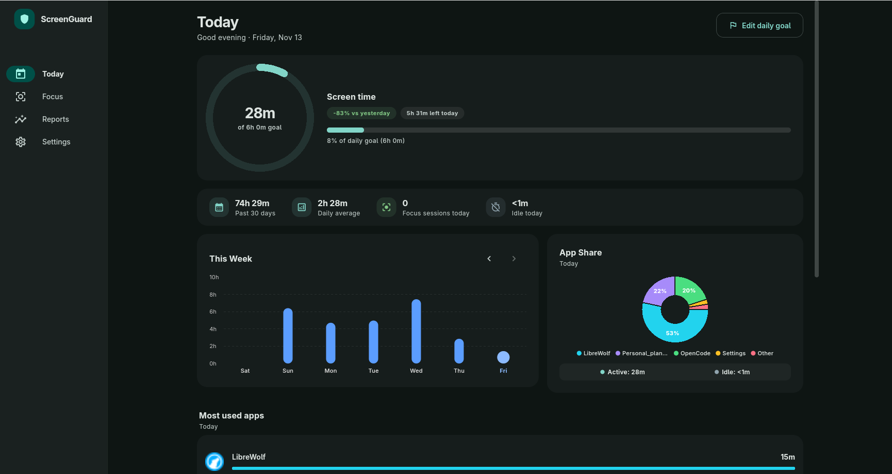

*Dashboard overview.*

---

### 2. Week-by-Week History, Reports & Per-App Detail
* **Multi-Week History**: Slide back week by week (`<` / `>`) to view previous weeks.
* **Interactive Day Inspector**: Tap any bar in the chart to load that specific day's app breakdown (e.g. `Most Used Apps (Wednesday, Aug 12)`).
* **Reports**: 30-day trends with daily average, total screen time, busiest day, focus sessions completed and days within your goal.
* **Per-App Pages**: Any app opens into its own page with 7-day usage, daily average and its current daily limit.

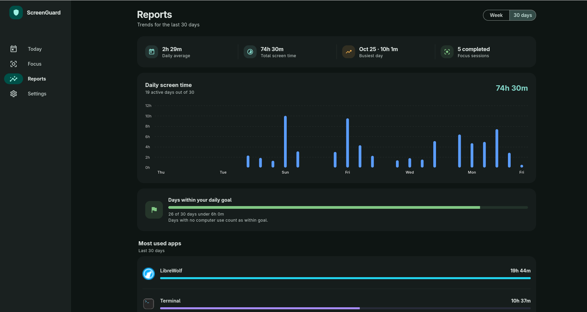

*Reports — 30-day trends.*

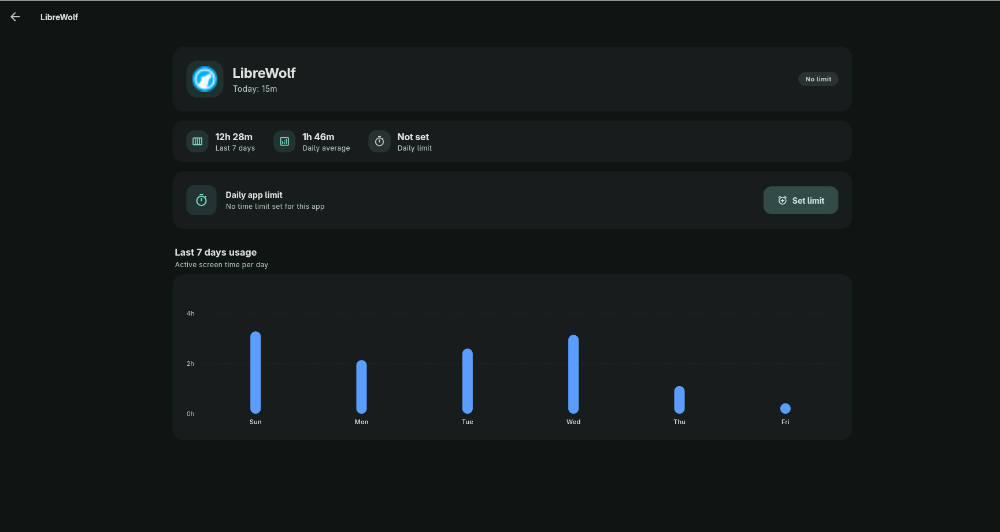

*Per-app page for LibreWolf.*

---

### 3. Daily App Time Limits & Lockout Screen
* **Custom & Preset Quotas**: Set daily limits per application using preset buttons (30m, 1h, 2h, 4h) or enter custom minute values.
* **90% Warning Threshold**: Desktop notification alerts you when you reach 90% of your allotted app limit.
* **100% Time's Up Lockout Screen**: When the daily limit is reached, ScreenGuard minimizes the active window and triggers a dedicated lockout overlay screen with options:
  * **Add 15 Minutes** (Temporary extension)
  * **Edit Limit**
  * **Back to Dashboard**

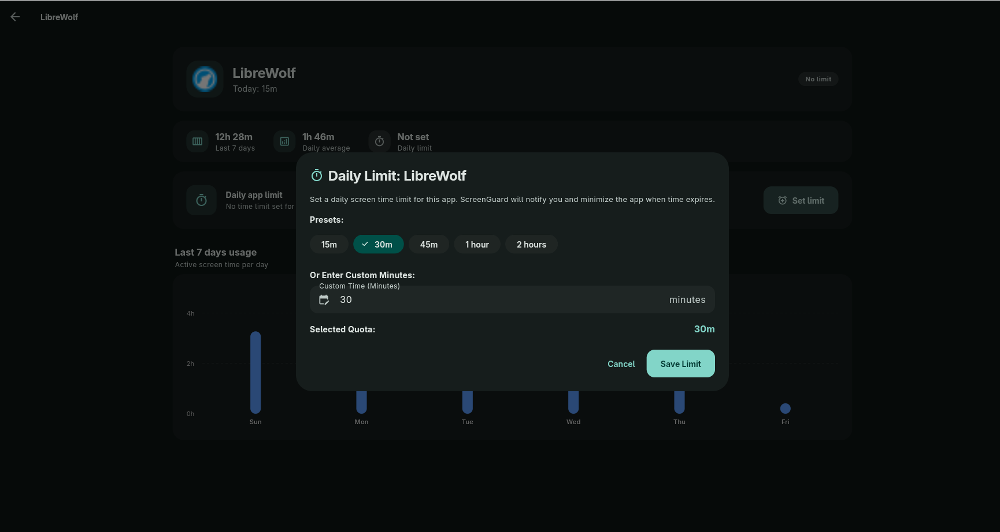

*Daily limit dialog — presets or custom minutes.*

---

### 4. Focus Mode (Pomodoro Timer & Distraction Blocker)
* **Animated Pomodoro Timer**: Preset sessions (`15m`, `25m`, `45m`, `60m`) with live circular countdown ring.
* **Pomodoro Cycles & Breaks**: Configure focus/break cycles; the timer automatically switches between focus and break periods.
* **Distraction Blocker**: Select distracting apps from a searchable app picker with grid or list layout. During an active focus session, ScreenGuard automatically minimizes blocked apps if opened.
* **Strict Auto-Close (Optional)**: Optionally close blocked apps instead of minimizing them when they are opened during a focus session.
* **Focus Statistics**: Tracks completed focus sessions per day.

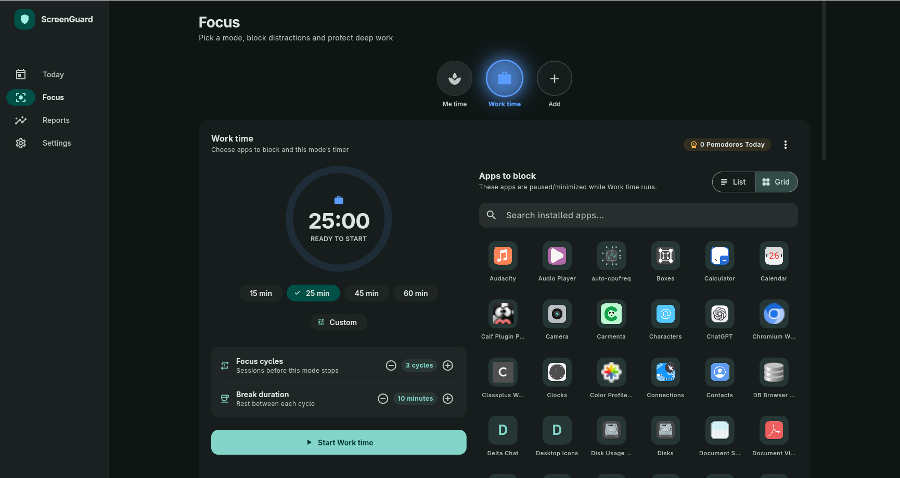

*Focus Mode with app picker. Window transparency is done by Blur My Shell.*

---

### 5. Settings & Controls
* **General**: Theme mode, desktop notifications, sound effects, custom audio, and alert events.
* **Limits & Pomodoro**: Pomodoro cycles, break duration, strict auto-close, and blocked-app handling.
* **Diagnostics**: Daemon status and opt-out anonymous diagnostics.
* **Updates**: Stable/beta channel, check frequency, and in-app update status.
* **Data**: Local database size/session count, date-range deletion, specific-date deletion, and clear-all.

> Window transparency in the screenshots below is done by the **Blur My Shell** GNOME extension, not by ScreenGuard.

#### General
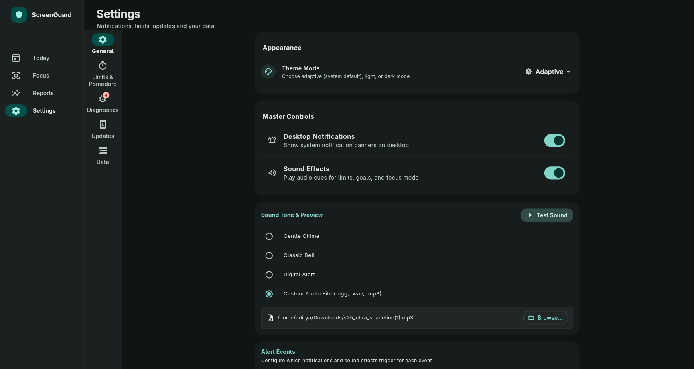

*Settings → General: theme mode, notifications, sounds and custom audio.*

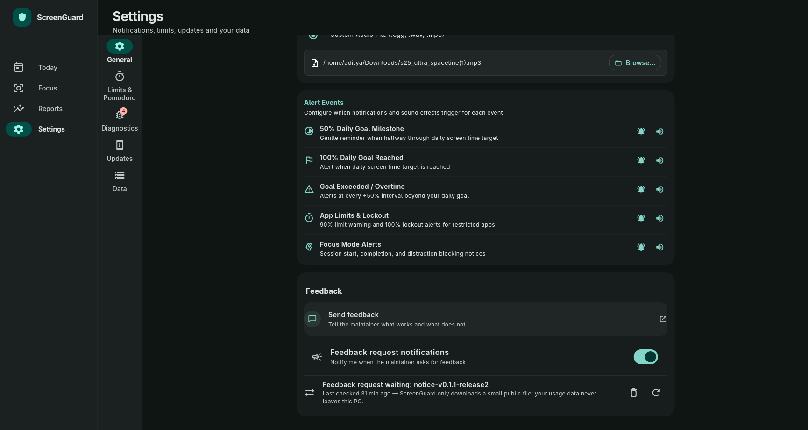

*Settings → General, continued: per-event alert toggles and the feedback controls.*

#### Limits & Pomodoro
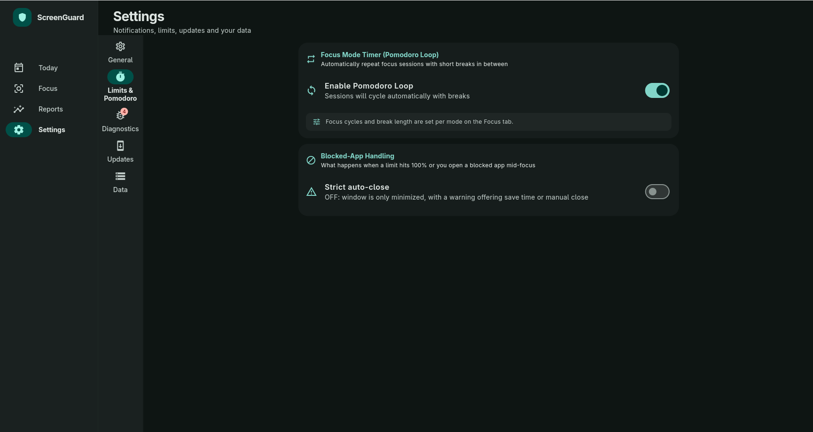

*Settings → Limits & Pomodoro.*

#### Diagnostics
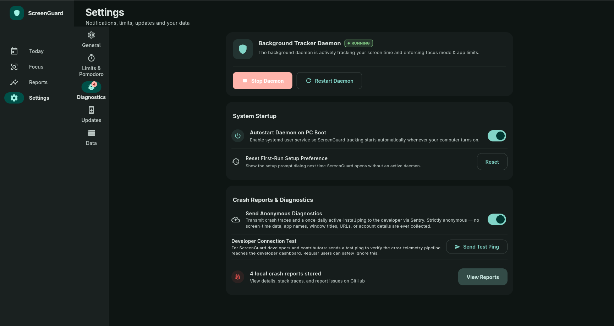

*Settings → Diagnostics: daemon status, autostart and anonymous diagnostics.*

#### Updates
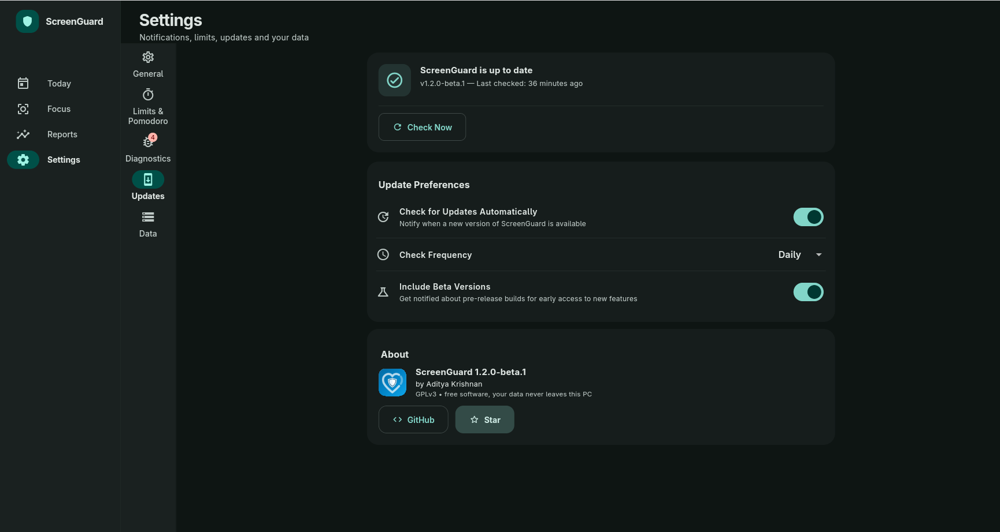

*Settings → Updates: check frequency, beta channel and current version.*

#### Data
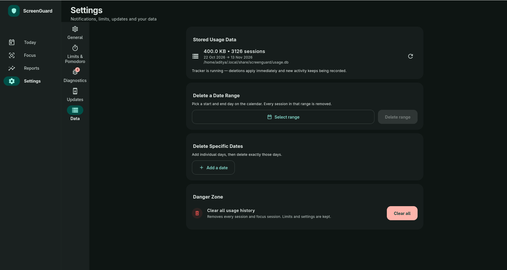

*Settings → Data: stored usage, range deletion and the danger zone.*

---

### 6. 100% Private & Local Storage
* Session logs are stored locally in SQLite (`~/.local/share/screenguard/usage.db`) in WAL journal mode.
* Your screen-time data never leaves your computer. No cloud accounts and no third-party tracking.
* Anonymous diagnostics are **opt-out**: crash traces and a once-daily active-install ping (random install ID, version, distro/desktop only). Disable them in **Settings → Diagnostics → Send Anonymous Diagnostics**.

---

## Architecture

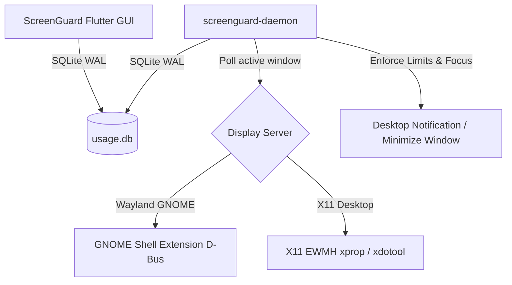

* **GUI App**: Built using Flutter & Material 3.
* **Daemon (`screenguard-daemon`)**: Lightweight background service compiling to a single native binary. It is currently written in Dart; the v1.5 roadmap targets a behavior-preserving C port with the same SQLite schema and control interfaces.
* **Extension (`screenguard@screenguard.app`)**: Native GNOME Shell Extension exporting active window title/class over D-Bus (`org.gnome.Shell.Extensions.ScreenGuard`).
* **X11 Backend**: Standard EWMH `_NET_ACTIVE_WINDOW` query via `xprop` and window minimization via `xdotool`.

---

## Installation

Choose your Linux distribution below. Simply copy and paste the commands into your terminal.

### Ubuntu / Debian / Zorin OS / Linux Mint / Pop!_OS

**Option A — APT repository (recommended, receives updates):**
```bash
sudo wget -O /usr/share/keyrings/screenguard.asc https://adityakrishnan005-a11y.github.io/ScreenGuard/apt/key.asc
echo "deb [signed-by=/usr/share/keyrings/screenguard.asc] https://adityakrishnan005-a11y.github.io/ScreenGuard/apt apt main" | sudo tee /etc/apt/sources.list.d/screenguard.list
sudo apt update && sudo apt install screenguard
```

**Option B — standalone `.deb`:**
```bash
wget https://github.com/adityakrishnan005-a11y/ScreenGuard/releases/download/v1.1.2/screenguard_1.1.2_amd64.deb && sudo apt install ./screenguard_1.1.2_amd64.deb -y
```

### Fedora / RHEL / Rocky Linux (Copr)
```bash
sudo dnf copr enable the-amibivert/screenguard
sudo dnf install screenguard
```

### openSUSE (Tumbleweed / Leap 15.6 / Leap 16.0)

One-click install (pick your release on the page):
[software.opensuse.org → screenguard](https://software.opensuse.org/download.html?project=home%3AAditya_K295&package=screenguard)

Or via the terminal (Tumbleweed shown — swap `openSUSE_Tumbleweed` for `openSUSE_Leap_16.0` or `openSUSE_Leap_15.6` on Leap):
```bash
sudo zypper addrepo https://download.opensuse.org/repositories/home:/Aditya_K295/openSUSE_Tumbleweed/home:Aditya_K295.repo
sudo zypper refresh && sudo zypper install screenguard
```
> Package builds are hosted on the [Open Build Service](https://build.opensuse.org/package/show/home:Aditya_K295/screenguard); a move into the official openSUSE distribution is planned.

### NixOS / Nix (nixpkgs)

ScreenGuard is officially submitted to upstream nixpkgs ([PR #584824](https://github.com/NixOS/nixpkgs/pull/584824)). Until it merges, Nix users can test the package directly from the PR branch:
```bash
nix-shell -E 'let pkgs = import (fetchTarball "https://github.com/adityakrishnan005-a11y/nixpkgs/archive/screenguard.tar.gz") {}; in pkgs.screenguard'
```
After merge: `nix profile install nixpkgs#screenguard` or `environment.systemPackages = [ pkgs.screenguard ];`.

### Arch Linux / Manjaro (custom repository)

> The AUR package is coming soon (AUR account registration is temporarily suspended). Until then, use our signed custom repository:

```bash
# 1. Import & locally trust the signing key
curl -fsSL https://adityakrishnan005-a11y.github.io/ScreenGuard/arch/key.asc -o /tmp/screenguard.asc
sudo pacman-key --add /tmp/screenguard.asc
sudo pacman-key --lsign-key 5E851C89E39A8FD573BF40EAEC671823CA28A37E

# 2. Append the repository to /etc/pacman.conf:
#    [screenguard]
#    Server = https://adityakrishnan005-a11y.github.io/ScreenGuard/arch/$arch
#    SigLevel = Required DatabaseRequired TrustedOnly

# 3. Install
sudo pacman -Sy && sudo pacman -S screenguard
```

---

## Getting Started

1. **Launch ScreenGuard** from your applications menu (or run `screenguard` in a terminal).
2. **Start the tracking daemon** (runs in the background and auto-starts on login):
   ```bash
   systemctl --user enable --now screenguard
   systemctl --user status screenguard   # verify it is active
   ```
3. **GNOME Wayland — enable the Shell extension** so ScreenGuard can read the active window:
   ```bash
   gnome-extensions enable screenguard@screenguard.app
   ```
   - On **Debian/Ubuntu/Fedora** the package post-install step enables AT-SPI accessibility and copies the extension for you.
   - On **Arch**, run `sudo /usr/share/screenguard/enable_fedora_a11y.sh` once, then enable the extension.
4. Open the dashboard to set **daily app limits** and start a **Focus Mode** session.

> **X11 sessions (KDE X11, XFCE, etc.)**: tracking works out-of-the-box via `xprop`/`xdotool` (install `xdotool`, `xorg-xprop`, and optionally `xprintidle` for idle detection). Native Wayland on non-GNOME compositors is not yet supported — use an X11 session there.

### Data & Privacy

* All session data is stored **locally** in a SQLite database at `~/.local/share/screenguard/usage.db` (WAL mode). Screen-time data, app names, window titles, and URLs never leave your machine.
* **Anonymous diagnostics are on by default and can be turned off.** ScreenGuard sends crash traces and one "active install" ping per day to Sentry. The ping contains a random install ID, the ScreenGuard version, distribution/desktop environment, display server, and build channel. Crash traces add the error message and stack trace. The payload contains no screen-time data, app names, window titles, URLs, file names, usernames, machine identifiers, or IP address. Sentry currently retains events for 30 days.
* To disable diagnostics, turn off **Settings → Diagnostics → Send Anonymous Diagnostics**. Doing so stops both crash reports and the daily ping.

---

## Building from Source (Developers)

If you prefer to clone the repository and build the binaries yourself:

```bash
# 1. Clone the repository
git clone https://github.com/adityakrishnan005-a11y/ScreenGuard.git
cd ScreenGuard

# 2. Install dependencies & build release bundle
flutter pub get
flutter build linux --release

# 3. Compile the background tracking daemon
dart compile exe bin/daemon.dart -o build/linux/x64/release/bundle/screenguard-daemon

# 4. (Optional) Create .deb and .rpm packages
nfpm package -f packaging/nfpm.deb.yaml -t dist/screenguard_1.1.2_amd64.deb
nfpm package -f packaging/nfpm.rpm.yaml -t dist/screenguard-1.1.2-1.x86_64.rpm
```

---

## The ScreenGuard Suite — where this is going

Every Linux user has felt it at some point: the desktop is *yours* in a way no other platform is — free, hackable, honest — and yet the day-to-day care stops there. On macOS and on phones, digital wellbeing is treated as a given; on Linux it barely exists.

ScreenGuard is the start of the answer: a wellbeing app built *for* Linux rather than ported to it — spoken to over D-Bus, backed by a kernel watchdog, and at home on GNOME and KDE on Wayland, and every major desktop on X11. But one app on one device is only step one. The screen-time story doesn't end when you close the laptop, so the suite grows beyond it:

* **🐧 ScreenGuard for Linux** — the core, evolving here (the roadmap below).
* **🤖 ScreenGuard for Android** — the pocket companion: same dashboard language, limits, and Focus Mode on your phone.
* **📺 ScreenGuard for TV** — the living room: the same wellbeing ideas for Android TV, built for a remote and a five-foot distance.

One **openness line** nothing in the suite will ever cross: your data is yours — any syncing will be peer-over-network between your own devices, never with a cloud or an account.

This is a multi-year effort, and each app gets its own repository the moment it's real. The full story — the why, the pace, and how to help — lives in the **[ScreenGuard Suite wiki page](https://github.com/adityakrishnan005-a11y/ScreenGuard/wiki/The-ScreenGuard-Suite)**.

---

## Roadmap & Future Enhancements

The next two milestones are focused on depth rather than breadth:

- **v1.2 — Major UI/UX Refresh**: A substantial pass over the interface and experience — clearer navigation, better accessibility, consistent visual polish, and fewer rough edges. Intentionally feature-light: the goal is to make what already exists feel better, not to add another long feature list.
- **v1.5 — C Daemon Port**: Rewrite the background daemon in C, using the current Dart implementation as the behavioral reference. The goal is lower runtime overhead and fewer dependencies without changing tracking, limits or Focus Mode behavior.

Beyond those milestones, the following feature work is planned but not yet assigned to a release:

- **Browser Extension (Web Tracking)**: Track active browser tabs (YouTube, Reddit, Docs) separately instead of grouping all browsing under one browser app.
- **Categorized App Group Limits**: Group multiple apps under a shared limit (e.g. limit all "Social Media" apps to 1h/day combined).
- **KDE Plasma & Hyprland / Sway Support**: Native Wayland protocols (`wlr-foreign-toplevel-management`) for non-GNOME Wayland compositors.
- **Data Export**: Export your historical screen time data to CSV or JSON formats for custom analysis.
- **Weekly Digest Reports**: Generate automated PDF or Markdown summaries of weekly productivity trends.
- **Strict Mode**: Optional hard lockouts that prevent adding extra extension time once a daily limit is reached.

---

## FAQ

**Tracking shows "unknown" on GNOME / Wayland?**
Ensure the ScreenGuard GNOME Shell extension is enabled (`gnome-extensions enable screenguard@screenguard.app`) and toolkit-accessibility is on. For sandboxed **Flatpak** apps, AT-SPI access must be granted — the Debian/Ubuntu/Fedora post-install script does this automatically, but if you installed via a method that skips post-install (e.g. Arch) or use user Flatpaks, re-run `sudo /usr/share/screenguard/enable_fedora_a11y.sh`.

**Nothing is tracked on KDE Plasma Wayland / Sway / Hyprland?**
Native Wayland tracking is currently only available on **GNOME Wayland**. For KDE and other compositors, log into an **X11 session** (e.g. Plasma X11), where ScreenGuard tracks via `xprop`/`xdotool`.

**The daemon isn't running.**
Check `systemctl --user status screenguard`. If inactive, run `systemctl --user enable --now screenguard`. Note it requires an active graphical session (`graphical-session.target`), so it only starts once you're logged in.

**How do I reset or move my data?**
Stop the daemon (`systemctl --user stop screenguard`), then delete `~/.local/share/screenguard/usage.db*` and relaunch to start fresh.

**How do I update ScreenGuard?**
Use your package manager — APT, DNF (Copr), and the Arch repo all deliver updates. Or download the latest release asset from the [releases page](https://github.com/adityakrishnan005-a11y/ScreenGuard/releases).

**Where do I report bugs?**
Open a [GitHub Issue](https://github.com/adityakrishnan005-a11y/ScreenGuard/issues). For **X11** problems, please attach a screenshot/video and your desktop environment + version so we can reproduce it.

---

## Feedback 💬

Users — on betas and stable releases — are the reason this project works, and I want to hear from you directly.

* **In the app** — *Settings → General → Send feedback* opens the feedback thread, where you can tell me what works and what does not.
* **On GitHub** — [Discussions](https://github.com/adityakrishnan005-a11y/ScreenGuard/discussions) for questions, ideas and general feedback (start with the [feedback thread](https://github.com/adityakrishnan005-a11y/ScreenGuard/discussions/5)); [Issues](https://github.com/adityakrishnan005-a11y/ScreenGuard/issues) for bugs.
* **Feedback requests** — when I need input on a specific decision, ScreenGuard downloads a small public file once a day and shows the request in the app. It is a read-only fetch of a static JSON file: no identifiers, no usage data, nothing leaves your machine except the app version in the request header. The notification can be turned off in *Settings → General*.

> **Reporting a bug?** Please attach a screenshot or video and name your desktop environment and version — especially on X11, so the issue can be reproduced.

---

## Contributing

Contributions are warmly welcomed! ScreenGuard is built by and for the Linux community.

Whether you want to:
* **Report a bug** or suggest a feature via GitHub Issues *(for X11 issue reports, please attach screenshot or video proof along with your DE name and version)*.
* **Help package ScreenGuard** for more distributions — openSUSE (OBS), NixOS (nixpkgs), or Gentoo (GURU).
* **Translate ScreenGuard** into new languages.
* **Submit Code / PRs**: Check out open issues and submit a Pull Request!

### How to Contribute
1. Fork the repository.
2. Create a new feature branch (`git checkout -b feature/amazing-feature`).
3. Commit your changes (`git commit -m 'Add amazing feature'`).
4. Push to the branch (`git push origin feature/amazing-feature`).
5. Open a Pull Request!

---

## License & Author

**ScreenGuard** is created and maintained by **Aditya Krishnan** ([aditya.krishnan005@gmail.com](mailto:aditya.krishnan005@gmail.com)).

Distributed under the [GNU General Public License v3.0 (GPLv3)](LICENSE).
